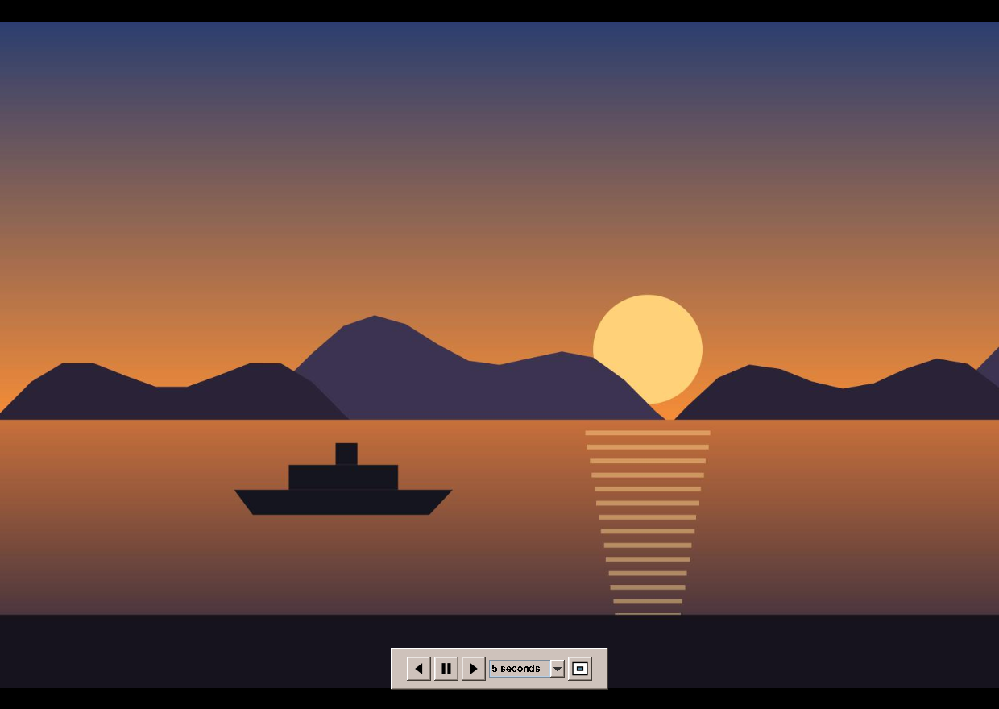

# amade-imageviewer

**amade-imageviewer** is the image viewer of the [amadeOS](https://github.com/datazuul/amadeos) desktop: it shows the pictures of a folder one by one, zooms, turns and prints them, plays them as a slideshow and shows what the camera wrote into them in a sidebar, with the place on a map. Built like the other amadeOS applications.


## Features

- **Opens** JPEG, PNG, GIF, BMP, TIFF and WebP: from the file manager, by drag and drop, with *Image → Open* (Ctrl+O) or on the command line. All pictures of the folder come along, sorted by name the way people count (IMG_9 before IMG_10), and a film strip below the picture shows them as thumbnails.
- **Browsing**: arrow keys, Page Up/Down, Space and Backspace, Home and End, the mouse wheel, or a click on the film strip.
- **Zoom**: fit to the window (Ctrl+0), actual size (Ctrl+1), in and out (Ctrl+plus, Ctrl+minus, Ctrl+wheel). A zoomed picture is moved with the mouse.
- **Turn and flip** (Ctrl+L, Ctrl+R): the picture appears upright as the camera's EXIF orientation says. *Image → Save Rotation* (Ctrl+S) writes a turn into the file: JPEGs losslessly with `jpegtran` (the package recommends `libjpeg-turbo-progs`), PNG and BMP by writing them anew.
- **Sidebar** (F9 or the ⓘ button) with the sections Description (title, caption, keywords, author, copyright from XMP, IPTC or EXIF), Camera (date, camera, lens, exposure, focal length, flash), File and Location. The link *All metadata…* at its end lists every tag.
- **Map**: for pictures with a GPS position the sidebar shows an OpenStreetMap map, but only after a click on *Show Map*, because loading it sends the position to openstreetmap.org. *Always show maps* (also in *Options*) skips the question. Tiles are kept for seven days in `~/.cache/amadeos/imageviewer/tiles`; *Open in Browser* and *Copy Position* work without loading any tile.
- **Title from the metadata** (*Options*): the window shows the picture's title instead of the file name, if it has a real one (not "OLYMPUS DIGITAL CAMERA").
- **Full screen** (F11, Esc to leave) and **slideshow** (F5): a mouse move shows a control bar with previous, play/pause, next, the interval and leave; it hides again after two seconds. Space pauses and a "Pause" sign appears; the arrow keys jump and start the interval anew. Intervals of 3, 5, 10 or 30 seconds, shuffle and loop in *Options → Slideshow*.

  
- **Move to Trash** (Delete), into the desktop trash where the file manager can restore it.
- **Copy** the picture (Ctrl+C) or its path (Ctrl+Shift+C), and **print** it (Ctrl+P), landscape for wide pictures.
- Five languages (English, Deutsch, Français, Español, Italiano), following the amadeOS desktop language; *Options → Language* overrides it.
- Theme colours and Motif look from [amade-commons](https://github.com/datazuul/amade-commons).

## Architecture

Java 25, Swing and Guice; start-up, theme and language come from `AmadeApplication` in amade-commons. Metadata is read with [metadata-extractor](https://github.com/drewnoakes/metadata-extractor), WebP and CMYK JPEGs with the [TwelveMonkeys](https://github.com/haraldk/TwelveMonkeys) ImageIO plugins.

| Package | Contents |
|---|---|
| `bootstrap` | `AmadeImageViewerApplication`, `ImageViewerModule` |
| `domain` | `Album` (the pictures of a folder and the current one), `Orientation` (the eight EXIF orientations as turns and flips), `Slideshow`, `Settings`, `PhotoInfo`, `GeoPosition`, `MapTiles`, `ZoomSteps`, `ImageFiles`, `TitleText` |
| `metadata` | `MetadataReader` (XMP before IPTC before EXIF) |
| `repository` | `ViewerPreferences` (`~/.config/amadeos/imageviewer/imageviewer.properties`), `TileStore` (map tiles, cached) |
| `service` | `ImageLoader`, `ImageTransforms`, `RotationSaver` (`jpegtran`), `ExifOrientation`, `Trash` (the XDG trash) |
| `ui.main` | window, presenter, menus, `ImageCanvas`, `FilmStrip`, `InfoSidebar` with `InfoRows` and `MapView`, `FullScreenWindow`, `PicturePrinter` |

The presenter knows the window only through the `MainView` interface, and loading runs in the background, so the tests drive the whole viewer (browsing, turning, slideshow, map opt-in) without Swing.

## Build and run

```sh
./gradlew run --args="~/Pictures"          # start with a folder or pictures
./gradlew test                             # Swing tests need a display: xvfb-run ./gradlew test
./gradlew deb                              # build/distributions/amade-imageviewer_<version>_all.deb
./gradlew installToAmadeOs                 # the .deb into ../amadeos/config/packages.chroot/ for the ISO build
```

If `../amade-commons` is checked out next to this repository, Gradle builds against that checkout instead of the JitPack version.

## Planned

- *Set as Desktop Background*, for the current workspace
- Animated GIFs and WebPs
- HEIC pictures from phones
- Simple editing: crop, brightness and contrast
- Editing the title, caption and keywords

## License

[EUPL-1.2](LICENSE)
